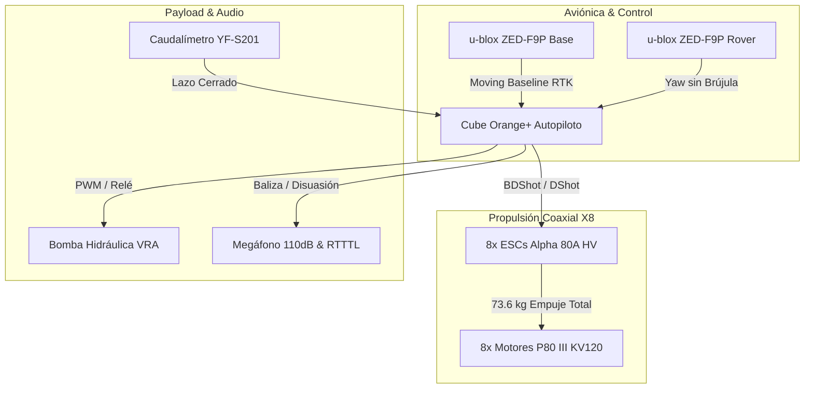

# ELECTRÓNICA PERLACO — STR-002 H3 v3.0
**Plataforma Aérea Agrícola de Gran Capacidad (MTOW 29.0 kg) — Octocóptero Coaxial X8**  
**Expediente Digital de Ingeniería, Aviónica de Redundancia Crítica y Auditoría HIL**  
**Desarrollado por:** Angel Imer Lara Colorado / **PERLACOLABS** — *Úrsulo Galván, Veracruz, México*

[](https://github.com/Weldimer/Prototipo-Dron-Agricola-Perlaco/actions)


> *\"Hasta la criatura más humilde sirve a la tierra. Lástima que la civilización solo sepa servirse de ella para pisarla.\"*
> — **PERLACOLABS**

---

## 🚁 Arquitectura del Sistema (Mermaid Diagram)



---

## 📚 Índice Documental Organizado (`/docs/reportes/`)

* 🌾 [**Aprendizaje y Justificación de Simulaciones Diarias en Diferentes Parcelas**](docs/reportes/aprendizaje_simulaciones_diarias_parcelas.md): Justificación técnica del aprendizaje continuo en Caña Maura y Limón Persa con física de gota, salinidad, 'sopa' y EMI.
* 📦 [**Lista Oficial de Materiales (BOM) y Datasheets**](docs/reportes/bom_lista_materiales_oficial.md): Desglose cuantitativo de componentes, fabricantes, datasheets y justificación técnica.
* 🛡️ [**Reporte Técnico de Inmunidad EMI, Moving Baseline y Pre-Arm**](docs/reportes/reporte_prearm_y_moving_baseline.md): Rumbo por fase GNSS sin magnetómetros e inmunidad a 300A.
* 🌪️ [**Control VRA Adaptativo al Clima y Filtro Notch BDShot**](docs/reportes/sistema_vra_adaptativo_clima_y_notch.md): Compensación eólica anti-deriva (*crab angle*) y atenuación de vibraciones a -40 dB.
* 🔊 [**Sistema de Emisión Sonora y Baliza de Piloto**](docs/reportes/sistema_audio_y_alertas.md): Baliza RTTTL (*Turkish March*) y megáfono disuasivo de fauna de 110 dB SPL.
* 🛰️ [**Ingesta de Multi-APIs Gratuitas y Aprendizaje Climático**](docs/reportes/apis_parcelas_agricolas.md): Fusión de Open-Meteo y NASA POWER para dosis adaptativa.
* 🧠 [**Matriz de Aprendizaje de Repositorios Open-Source**](docs/reportes/aprendizaje_repositorios_estudiados.md): Transferencia tecnológica de ArduPilot, pymavlink, PX4 BMS y DroneCAN.
* 🛠️ [**Historial de Errores y Soluciones de Software**](docs/reportes/historial_errores_y_soluciones.md): Diagnóstico de sintaxis en Python 3.13 y librerías.
* 🌪️ [**Justificación Técnica Octocóptero X8 para Vientos 'Nortes'**](docs/reportes/justificacion_octocoptero_x8_nortes.md): Análisis aerodinámico del octocóptero X8 con reserva T/W 2.53:1.

---

## 🤖 Automatización y Simulaciones

* 🔄 [**Workflow GitHub Actions Cron (2x/día)**](.github/workflows/daily_learning_simulation.yml): Ingesta Multi-API automatizada en tiempo real con actualización de `simulation/historical_learning_log.csv`.

---

## 📜 Cita Académica e Institucional

```bibtex
@software{LaraColorado_STR002_H3_2026,
  author = {Lara Colorado, Angel Imer},
  title = {Prototipo Dron Agrícola ELECTRÓNICA PERLACO - STR-002 H3 v3.0},
  url = {[https://github.com/Weldimer/Prototipo-Dron-Agricola-Perlaco](https://github.com/Weldimer/Prototipo-Dron-Agricola-Perlaco)},
  year = {2026},
  publisher = {PERLACOLABS}
}
```

---
**ELECTRÓNICA PERLACO / PERLACOLABS** — *Innovación y soberanía tecnológica para el campo mexicano.*