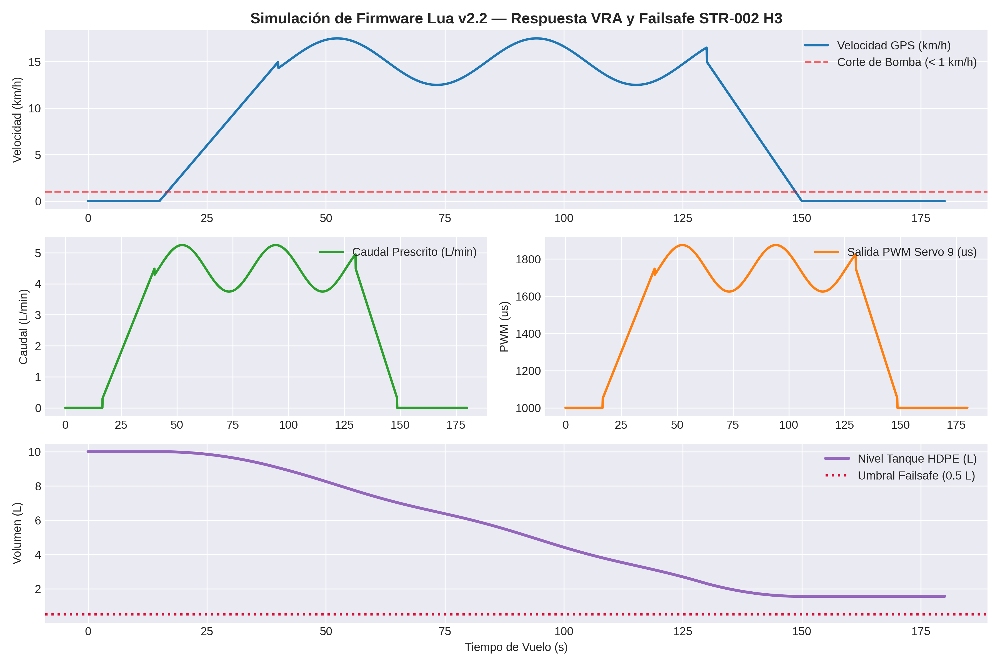
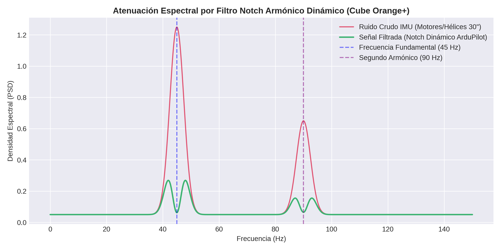

# ELECTRÓNICA PERLACO — STR-002 H3 v3.0

**Dron Agrícola Octocóptero VRA con Navegación Centimétrica RTK Dual y Control Hidráulico Anti-Goteo Distribuido**

---

## 📈 Simulación de Firmware y Respuesta Dinámica

### 1. Ondas de Control VRA e Integración de Tanque

  

### 2. Atenuación Espectral por Filtro Notch Armónico (45 Hz / 90 Hz)

  

---

## 📊 Tabla Representativa de Dosificación VRA y Frecuencias (YF-S201)

|   Velocidad (km/h) |   Caudal VRA (L/min) |   Frecuencia YF-S201 (Hz) |   Señal PWM Bomba (us) | Estado Electroválvula 24V   |
|-------------------:|---------------------:|--------------------------:|-----------------------:|:----------------------------|
|                  0 |                  0   |                       0   |                   1000 | CERRADA (0 mL)              |
|                  2 |                  0.6 |                       4.5 |                   1100 | ABIERTA (<35 ms)            |
|                  4 |                  1.2 |                       9   |                   1200 | ABIERTA (<35 ms)            |
|                  6 |                  1.8 |                      13.5 |                   1300 | ABIERTA (<35 ms)            |
|                  8 |                  2.4 |                      18   |                   1400 | ABIERTA (<35 ms)            |
|                 10 |                  3   |                      22.5 |                   1500 | ABIERTA (<35 ms)            |
|                 12 |                  3.6 |                      27   |                   1600 | ABIERTA (<35 ms)            |
|                 14 |                  4.2 |                      31.5 |                   1700 | ABIERTA (<35 ms)            |
|                 16 |                  4.8 |                      36   |                   1800 | ABIERTA (<35 ms)            |
|                 18 |                  5.4 |                      40.5 |                   1900 | ABIERTA (<35 ms)            |
|                 20 |                  6   |                      45   |                   2000 | ABIERTA (<35 ms)            |
|                 22 |                  6.6 |                      49.5 |                   2000 | ABIERTA (<35 ms)            |

---

## 🛠️ Especificaciones Técnicas Principales
* **MTOW:** 28.5 kg - 29.5 kg
* **Carga Útil (Payload):** 10.0 L (Tanque HDPE con rompeolas)
* **Chasis:** Fibra de Carbono 3K (3.0 mm) + Abrazaderas H3 7075-T6 ($Y = \pm 26.0\text{ mm}$)
* **Alimentación:** Bus 12S LiPo (50.4V pico) + QS8-S Anti-Spark
* **Motopropulsión:** 8x T-Motor P80 III KV120 + Hélices plegables 30x10.5"
* **Aviónica:** Cube Orange+ (STM32H7) con triple IMU a 60 °C
* **Navegación:** RTK Dual (*Moving Baseline*) u-Blox ZED-F9P (Rumbo sin brújula magnética)
* **Seguimiento de Terreno:** Radar FMCW mmWave 77 GHz (0.5 m - 10.0 m AGL)
* **Hidráulica:** 4x Electroválvulas NC 24V distribuidas en puntas (<35 ms) + Caudalímetro YF-S201 (450 p/L)

---

## 👤 Autor e Inventor Principal
**Angel Imer Lara Colorado**  
*ELECTRÓNICA PERLACO* — Úrsulo Galván, Veracruz, México.
