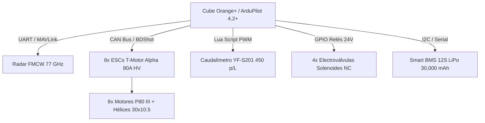

# ELECTRÓNICA PERLACO — STR-002 H3 v3.0 / v2.5


**Expediente Técnico, Normativo y de Simulación de la Plataforma Agrícola X8**  
**Autor e Inventor Principal:** Angel Imer Lara Colorado — *PERLACOLABS / ELECTRÓNICA PERLACO* (Úrsulo Galván, Veracruz, México)

---

## 🔌 Arquitectura de Interconexión Hardware & Aviónica



---

## 🗂️ Estructura y Organización del Repositorio

```
Prototipo-Dron-Agricola-Perlaco/
├── ⚙️ firmware/      # Suite de 18 archivos de parámetros, scripts Lua VRA, BMS 12S y radio
├── 📐 cad/           # Planos vectoriales DXF y generadores CAM para fresado CNC en fibra de carbono
├── 🛰️ mission/       # Rutas WPL 110, mapeador NDVI Earth Engine e ingesta de APIs agroclimáticas
├── 📊 simulation/    # Simuladores numéricos Python, logs MAVLink CSV, análisis FEA y HIL
├── 📜 docs/          # Manuales de campo, certificaciones, marco normativo AFAC/SADER y estudio técnico
└── 🖼️ assets/        # Infografías HD, mapas de calor NDVI y paneles de telemetría de vuelo
```

---

## 📚 Documentación de Ingeniería y Operación (`/docs`)

* 📦 [**Lista Oficial de Materiales (BOM) y Datasheets**](docs/bom_lista_materiales_oficial.md): Desglose cuantitativo de componentes, fabricantes, enlaces a datasheets y justificación de ingeniería.

* 🌪️ [**Control VRA Adaptativo al Clima y Filtro Notch BDShot**](docs/sistema_vra_adaptativo_clima_y_notch.md): Compensación de deriva de gota en tiempo real, ángulo de cangrejo anti-deriva y atenuación de vibraciones en las 8 hélices de 30''.

* 🛡️ [**Reporte Técnico de Inmunidad EMI, Moving Baseline y Pre-Arm**](docs/reporte_prearm_y_moving_baseline.md): Inmunidad magnética a 300A mediante doble ZED-F9P, calibración de rumbo sin brújula y auditoría de 8 ESCs BDShot.

* 🌪️ [**Justificación Técnica Octocóptero X8 para Vientos 'Nortes' (>127 km/h)**](docs/justificacion_octocoptero_x8_nortes.md): Análisis aerodinámico de la configuración de 8 motores, reserva T/W de 2.53:1 y respuesta en Úrsulo Galván, Ver.

* 🔊 [**Sistema de Emisión Sonora y Baliza de Piloto**](docs/sistema_audio_y_alertas.md): Control de audio RTTTL (Turkish March), baliza de localización y disuasión de fauna vía EdgeTX/MAVLink.

* 📑 [**Estudio Técnico y de Ingeniería Integral**](docs/estudio_dron_agricola.md): Análisis dimensional, tren motriz 12S, cálculo de Z_CG e hidráulica VRA.
* 🛡️ [**Certificación de Redundancia X8, FEA y Sloshing**](docs/certificacion_falla_motor_y_fea.md): Evaluación de falla de motor en vuelo (Ratio T/W 2.22:1), Von Mises en abrazaderas H3 (FS = 4.18) y atenuación de oleaje.
* ⚖️ [**Marco Normativo y Regulación Agroaeronáutica**](docs/normativa_regulacion_aeronautica.md): Cumplimiento AFAC (CO AV-07.02/12 R3 para RPAS >25kg), SENASICA/SADER (NOM-052-FITO) e IFT.
* 📊 [**Reporte de Simulación Técnica de Misión Agrícola**](docs/reporte_simulacion_mision_real.md): Telemetría completa de vuelo de 12 min, perfil hídrico VRA y dinámica de batería 12S.
* 🛰️ [**Conexión de APIs Públicas y Gestión de Parcelas**](docs/apis_parcelas_agricolas.md): Ingesta de datos agroclimáticos en tiempo real (Open-Meteo / NASA POWER) para Úrsulo Galván, Ver.
* 🧠 [**Matriz de Aprendizaje de Repositorios**](docs/aprendizaje_repositorios_estudiados.md): Síntesis de lecciones extraídas de ArduPilot Lua API, MAVLink WPL y modelos electroquímicos.
* 📘 [**Manual de Operación en Campo**](docs/manual_operacion_campo.md): Protocolo de despegue/aterrizaje y checklist pre-vuelo.
* 🛠️ [**Plan de Mantenimiento Preventivo**](docs/plan_mantenimiento_preventivo.md): Torques de apriete, limpieza VRA y bitácora de componentes.

---

## 📈 Paneles de Telemetría e Inspección Visual (`/assets`)


---

## 🦉 Lema y Filosofía de Proyecto

> *«Hasta la criatura más humilde sirve a la tierra. Lástima que la civilización solo sepa servirse de ella para pisarla.»*
> 
> — **ELECTRÓNICA PERLACO / PERLACOLABS** — *Úrsulo Galván, Veracruz, México*
