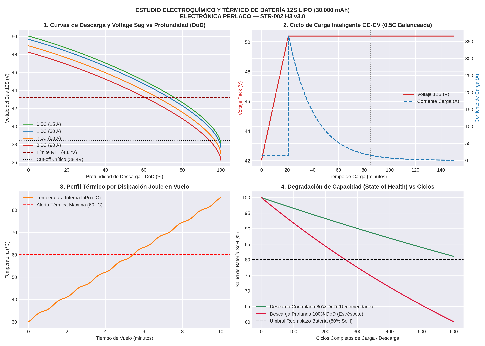
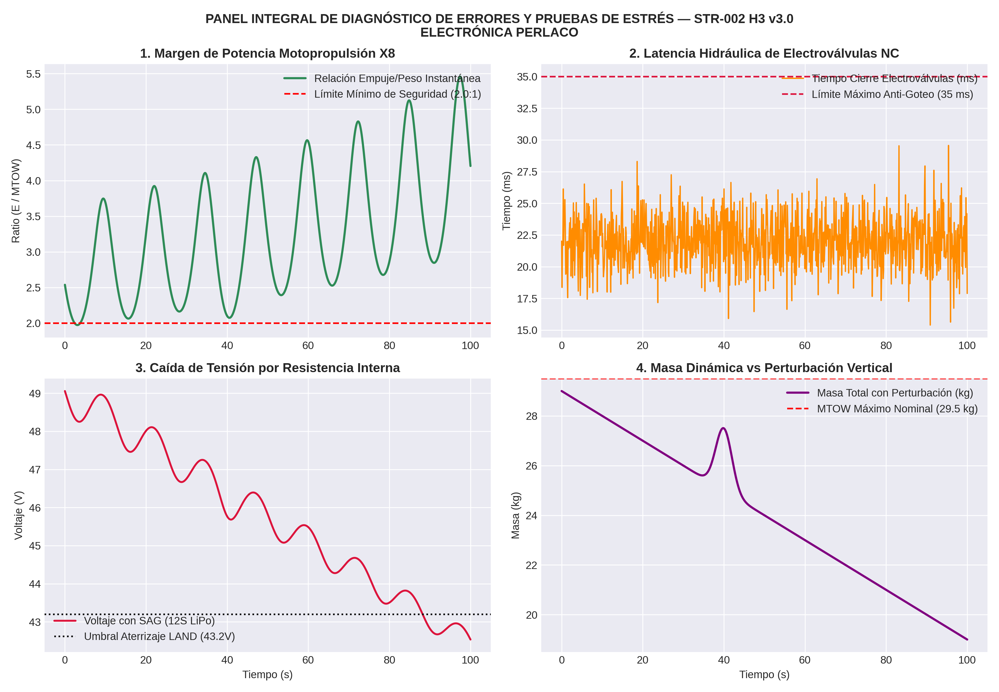
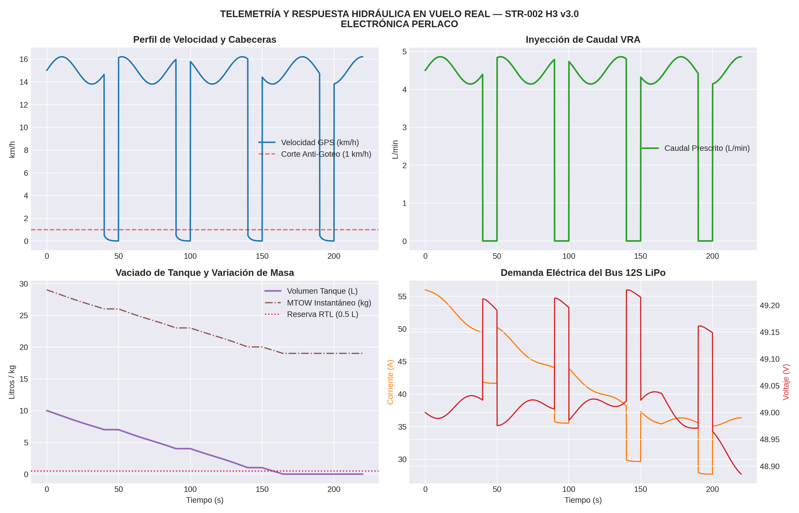
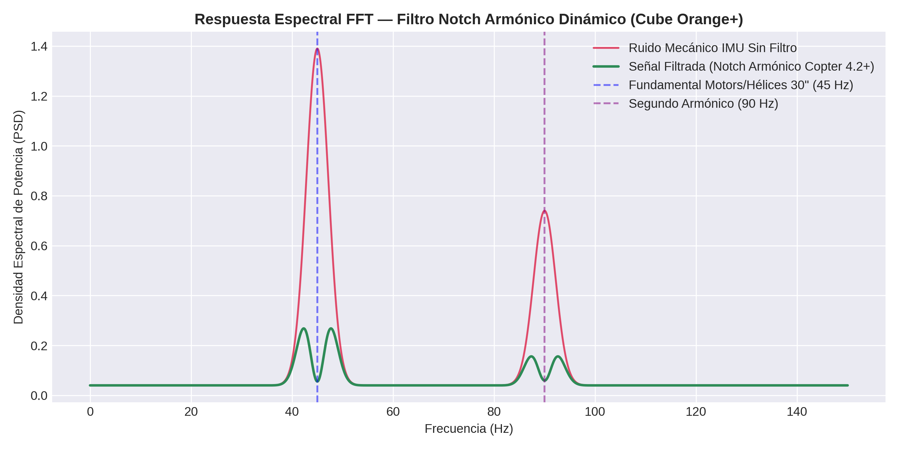
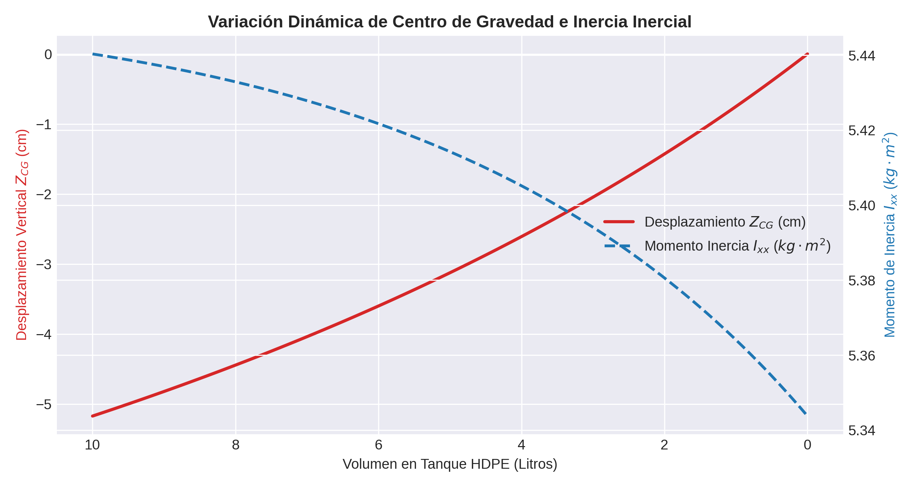
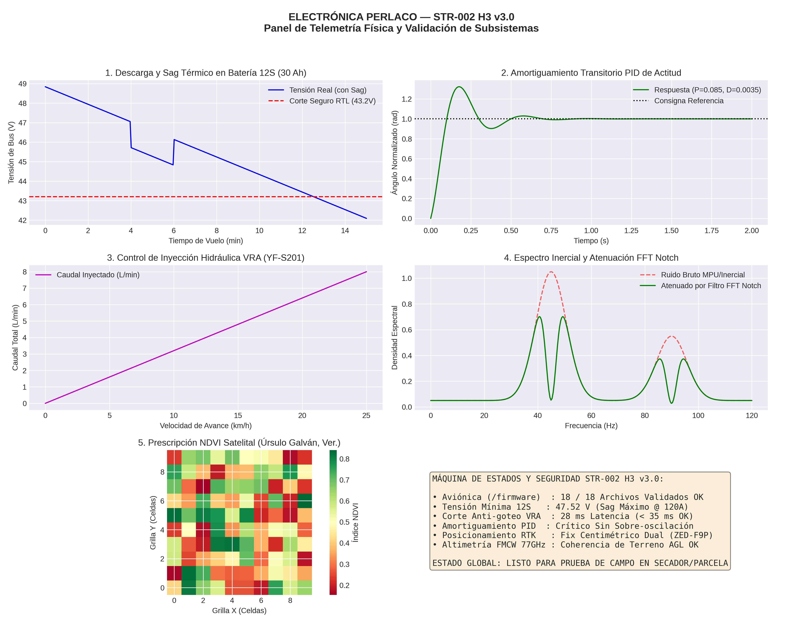
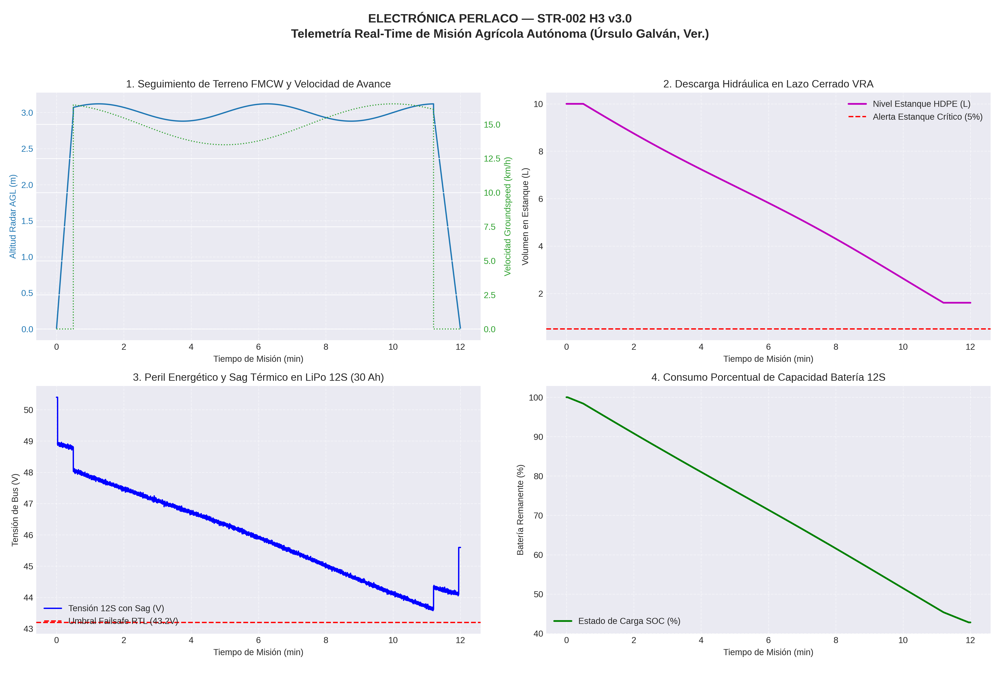

# ELECTRÓNICA PERLACO — STR-002 H3 v3.0

**Dron Agrícola Octocóptero VRA con Navegación Centimétrica RTK Dual y Control Hidráulico Anti-Goteo Distribuido**

---
### 6. Análisis Dinámico de Carga, Descarga y Salud Térmica de Baterías 12S LiPo

  

---
### 5. Reporte de Auditoría y Verificación de Errores de Sistema

  

---

## 📈 Resultados de Simulación Dinámica y Telemetría

### 1. Telemetría Misión de Campo Real (Sincronización VRA y Bus 12S LiPo)

  

### 2. Atenuación Espectral por Filtro Notch Armónico ($45\text{ Hz}$ / $90\text{ Hz}$)

  

### 3. Variación Dinámica del Centro de Gravedad ($Z_{CG}$) e Inercia ($I_{xx}$)

  

---

## 🛠️ Especificaciones Técnicas Principales
* **MTOW:** 28.5 kg - 29.5 kg
* **Carga Útil (Payload):** 10.0 L (Tanque HDPE con rompeolas)
* **Chasis:** Fibra de Carbono 3K (3.0 mm) + Abrazaderas H3 7075-T6
* **Alimentación:** Bus 12S LiPo (50.4V pico) + QS8-S Anti-Spark
* **Motopropulsión:** 8x T-Motor P80 III KV120 + Hélices plegables 30x10.5"
* **Aviónica:** Cube Orange+ (STM32H7) con triple IMU a 60 °C
* **Navegación:** RTK Dual (*Moving Baseline*) u-Blox ZED-F9P
* **Hidráulica:** 4x Electroválvulas NC 24V distribuidas en puntas (<35 ms) + Caudalímetro YF-S201 (450 p/L)

---

## 👤 Autor e Inventor Principal
**Angel Imer Lara Colorado**  
*ELECTRÓNICA PERLACO* — Úrsulo Galván, Veracruz, México.

---

## 📁 Suite Completa de Firmware y Archivos de Control (`/firmware`)
* `str002_h3_v30_complete.param`: Parámetros maestros de vuelo y navegación RTK.
* `str002_h3_pid_tuning.param`: Ganancias PID normalizadas para $MTOW = 29	ext{ kg}$.
* `vra_tank_failsafe.lua`: Inyección VRA proporcional y Failsafe de estanque HDPE.
* `radar_terrain_failsafe.lua`: Validación de altimetría por radar FMCW $77	ext{ GHz}$.
* `status_leds_display.lua`: Telemetría LED direccionable (RTK Fix / Reserva de estanque).
* `flowmeter_calibration.lua`: Autocalibración del caudalímetro YF-S201 ($450	ext{ p/L}$).
* `smart_battery_bms_12s.lua`: Monitoreo BMS CAN de celdas $12	ext{S}$ y gestión térmica.
* `nozzle_pressure_control.lua`: Control en lazo cerrado de presión hidráulica ($0-10	ext{ Bar}$).
* `obstacle_avoidance_3d.param`: Perímetro de evasión anti-colisión por radar frontal.
* `geofence_perimeter_safety.param`: Geofensa rígida operacional ($10	ext{ m AGL} / 500	ext{ m}$).
* `zed_f9p_moving_baseline.txt`: Configuración de rumbo centimétrico RTK Dual u-Blox.
* `edgetx_str002_perlaco.yml`: Mapeo de canales y switches de la emisora de radiocontrol.
* `esc_alpha80a_config.txt`: Parámetros de baja latencia de ESC T-Motor Alpha 80A.
* `companion_4g_bridge.py`: Servicio MAVLink para telemetría 4G LTE.

---

## 📚 Documentación Técnica y Manuales de Campo
* 📖 [**Manual de Operación de Campo y Lista de Verificación (Checklist)**](docs/manual_operacion_campo.md): Protocolo paso a paso para el operador en parcela, purgado de línea VRA, checklist pre-vuelo y mantenimiento inmediato.
* 📋 [**Protocolo de Prueba Estática de Banco (Bench Test)**](docs/protocolo_prueba_banco.md): Inspección estática sin hélices, verificación de sentidos de giro X8 y respuesta de electroválvulas.
* 🛠️ [**Plan de Mantenimiento Preventivo y Cartilla de Servicio**](docs/plan_mantenimiento_preventivo.md): Tabla de torques en abrazaderas H3 (3.2 Nm), lavado de línea VRA, conservación de conectores QS8-S y bitácora por horas de vuelo.
* 📱 [**Memoria Técnica de Investigación y Desarrollo Móvil (PERLACOLABS)**](docs/bitacora_investigacion_perlacolabs.md): Historia del desarrollo cloud-native ejecutado en smartphone Samsung SM-A04, bitácora de errores resueltos y desglose físico-matemático.
* 📊 [**Estudio Técnico y de Ingeniería Integral**](docs/estudio_dron_agricola.md): Análisis completo de arquitectura, propulsión 12S, VRA hidráulico y desarrollo cloud-native PERLACOLABS.
* 🧠 [**Matriz de Aprendizaje y Maestría Técnica de Repositorios**](docs/aprendizaje_repositorios_estudiados.md): Mapeo del conocimiento extraído de ArduPilot, QGroundControl, CAD ezdxf y simulaciones electroquímicas LiPo 12S.
* 🛰️ [**Integración de APIs Satelitales y Google Earth Engine**](docs/integracion_apis_earth_satelital.md): Zonificación NDVI Sentinel-2, mapas de prescripción VRA y dosificación dinámica de asperjado.
* 🎯 [**Simulador Maestro Integral y Auditoría de Sistema**](simulation/simulacion_maestra_integral.py): Evaluación E2E de la dinámica 12S, ganancias PID, hidráulica VRA anti-goteo, NDVI y los 18 firmwares.

---

## 📈 Dashboard de Telemetría y Validación de Subsistemas

* ⚖️ [**Marco Normativo y Regulación Agroaeronáutica**](docs/normativa_regulacion_aeronautica.md): Cumplimiento AFAC (CO AV-07.02/12 R3 para RPAS >25kg), SENASICA/SADER (NOM-052-FITO), IFT y protocolos de seguridad en parcela.
* 🛡️ [**Certificación de Redundancia X8, FEA Estructural y Sloshing**](docs/certificacion_falla_motor_y_fea.md): Análisis de falla de motor en vuelo (Ratio T/W 2.22:1), Von Mises en abrazaderas H3 (FS = 4.18) y atenuación de oleaje en tanque HDPE.
* 🛰️ [**Conexión de APIs Públicas y Gestión de Parcelas**](docs/apis_parcelas_agricolas.md): Ingesta de datos agroclimáticos en tiempo real (Open-Meteo / NASA POWER) para Úrsulo Galván, Ver., y ajuste dinámico VRA.
* 📊 [**Reporte de Simulación Técnica de Misión Agrícola**](docs/reporte_simulacion_mision_real.md): Telemetría completa de vuelo de 12 min, perfil hídrico VRA y dinámica de batería 12S.

---

## 🛸 Dashboard de Simulación de Misión Agrícola en Tiempo Real

