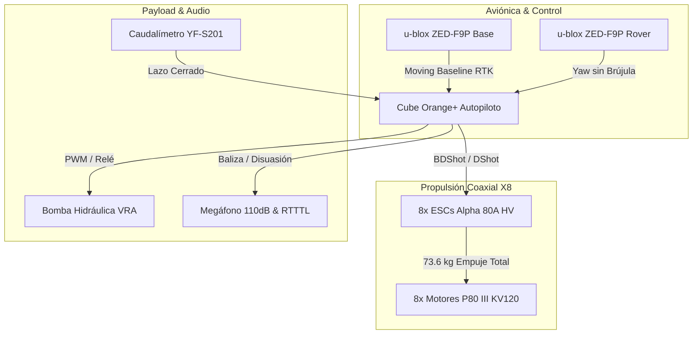

# ELECTRÓNICA PERLACO — STR-002 H3 v3.0
**Plataforma Aérea Agrícola de Gran Capacidad (MTOW 29.0 kg) — Octocóptero Coaxial X8**  
**Diseño de Ingeniería, Aviónica de Redundancia Crítica y Simulación HIL en Lazo Cerrado**  
**Desarrollado por:** Angel Imer Lara Colorado / **PERLACOLABS** — *Úrsulo Galván, Veracruz, México*

[](https://github.com/Weldimer/Prototipo-Dron-Agricola-Perlaco/actions)


> *\"Hasta la criatura más humilde sirve a la tierra. Lástima que la civilización solo sepa servirse de ella para pisarla.\"*
> — **PERLACOLABS**

---

## 🚁 Arquitectura del Sistema (Mermaid Diagram)



---

## 📂 Mapa Estructurado del Repositorio

```text
Prototipo-Dron-Agricola-Perlaco/
├── .github/workflows/         # Pipeline CI/CD de GitHub Actions
├── assets/                    # Logotipos e imágenes institucionales
├── cad/                       # Planos CAD/CAM y modelos de estanque HDPE
├── docs/                      # Memorias técnicas, BOM, atenuación y reportes
│   ├── apis_parcelas_agricolas.md
│   ├── aprendizaje_repositorios_estudiados.md
│   ├── bom_lista_materiales_oficial.md
│   ├── bom_lista_materiales_oficial.csv
│   ├── justificacion_octocoptero_x8_nortes.md
│   ├── reporte_prearm_y_moving_baseline.md
│   ├── reporte_simulacion_audio.md
│   └── sistema_audio_y_alertas.md
├── firmware/                  # Parámetros ArduPilot y Scripts Lua
│   ├── dynamic_harmonic_notch.param
│   ├── moving_baseline_dual_gnss.param
│   ├── pilot_audio_beacon.lua
│   ├── prearm_health_audit.lua
│   ├── str002_h3_v30_complete.param
│   └── vra_wind_compensation.lua
├── mission/                   # Ingesta Multi-API (Open-Meteo, NASA POWER)
│   └── agri_api_integration.py
├── simulation/                # Motores de simulación HIL y logs CSV
│   ├── aprendiz_repositorios.py
│   ├── log_mision_integral_h3.csv
│   ├── simulacion_mision_integral.py
│   └── simulacion_prearm_y_moving_baseline.py
├── CITATION.cff               # Cita académica oficial
├── LICENSE                    # Licencia de Software Abierto MIT
└── README.md                  # Portada institucional
```

---

## ⚡ Especificaciones Clave de Ingeniería

* **Configuración Propulsiva:** Octocóptero Coaxial X8 ($8\times$ T-Motor P80 III KV120 + $8\times$ Alpha 80A HV).
* **Empuje Total Disponible:** $73.6\text{ kg}$ ($T/W = 2.53:1$, reserva del $60.5\%$ contra 'Nortes' $>127\text{ km/h}$).
* **Inmunidad Electromagnética:** Doble GNSS u-blox ZED-F9P (Moving Baseline RTK) con rumbo por fase de portadora sin magnetómetros.
* **Atenuación de Vibraciones:** Filtro Notch dinámico BDShot RPM (`-40 dB` de supresión armónica).
* **Payload & Audio:** Estanque de $10.0\text{ L}$ HDPE con baffle anti-sloshing, megáfono disuasivo de $110\text{ dB SPL}$ y baliza RTTTL (*Turkish March*).

---

## 📜 Cita Académica e Institucional

Para citar esta investigación o el desarrollo de este prototipo:

```bibtex
@software{LaraColorado_STR002_H3_2026,
  author = {Lara Colorado, Angel Imer},
  title = {Prototipo Dron Agrícola ELECTRÓNICA PERLACO - STR-002 H3 v3.0},
  url = {[https://github.com/Weldimer/Prototipo-Dron-Agricola-Perlaco](https://github.com/Weldimer/Prototipo-Dron-Agricola-Perlaco)},
  year = {2026},
  publisher = {PERLACOLABS}
}
```

---
**ELECTRÓNICA PERLACO / PERLACOLABS** — *Innovación y soberanía tecnológica para el campo mexicano.*